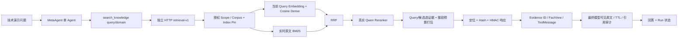

# 系统设计与责任边界

RAG 仓库负责来源审批、语料/索引一致性、向量与词法召回、融合、真实重排、选证据、预算和可签名的定位响应。MetaAgent 负责可信会话边界、有限 HTTP 调用、独立协议验证、Evidence/FactView、上下文压缩、TTL、引用审计和回答状态。检索作为独立 HTTP 服务，使模型依赖、索引发布和耗时故障不进入 Agent 图；代价是增加网络延迟和双仓库契约维护。

可直接复用的 BM25、分词、Candidate、RRF 已从 `evaluation/retrievers.py` 抽到 `services/retrieval_algorithms.py`，原 eval 继续重导出，异常类型由 `services/errors.py` 保持兼容。Embedding 复用现有 `adapters/embedding.py`。Reranker 从原离线 native API 输入与 index→candidate 解释方式提取，**没有继承缓存**。原 medical_v3 的 query-only coverage/atomic-pack 思想用于新技术语料；未直接导入绑定医学 facet、Gold、PDF 页及 tiktoken 的 eval 模块。新选择器按 query 中的源标题、词项覆盖和当前候选相关性排序，UTF-8 字节估算整段预算。

`ArchivedDenseRetriever`、冻结 Top-5、Gold、历史查询与离线指标不进入运行时。服务只读 8 份 CC0 自建技术文档、15 片段及静态文档向量。Gold 位于 tests/fixtures/hybrid_eval，独立 hash 冻结；Dockerfile 专用白名单仅复制 src 和 fixtures/hybrid_demo，Gold 不进镜像。

Dense 模型 `qwen3.7-text-embedding` / 1024 维 / cosine / namespace `isolated-hybrid-demo-v1`。启动检查 corpus pin、index pin、model/dimension、完整 chunk 集合、原文 hash、范围/版本；每次查询再次检查两个文件指纹，漂移拒绝使用。文档身份 UUID5(source URI)，chunk 身份 UUID5(source URI@version#section)；text SHA256 校验原文，不把 Evidence ID 当 doc_ref。

全部默认关闭/非生产/无患者，只有专用 bearer、operator、hybrid-demo scope、配置可用域通过。模型只给 query/domain，不能改审批、release、pins、token、预算或扩大域。技术文档内容仅作为工具数据。

技术债：静态文件和单进程 BM25 不提供生产 P2-E publish/update/delete/rebuild、租户隔离与原子版本切换；HMAC 与 bearer 共用演示密钥，生产需独立密钥管理与传输授权；当前选择器/阈值只在小型合成集上验收；独立语义/临床审核尚缺。Schema 双份独立实现并做导出一致性验证，不跨仓库导入运行时。
