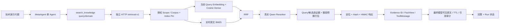

# 可展示的工程证据

可如实表述：实现跨仓库只读Hybrid检索HTTP服务，以真实Qwen query embedding / cosine Dense、实时BM25、RRF、真实Qwen reranker和来源预算选择连接MetaAgent Evidence/FactView与回答；新协议验签、双pin、范围/原文hash、隔离身份与故障状态可追踪。自建8份CC0文档/15chunks，冻结Gold与运行时分离，完成终版五策略与新输入52次HTTP评测、另5次零词重合探针、41次真实本机Agent运行（含诊断失败）、两次实际Docker闭环验证；隔离PostgreSQL回归RAG252、MetaAgent305通过。真实数值见03/04/05，不能省略失败。

不可宣称：生产医疗部署、真实患者准确率、临床审核、全库180 PDF在线能力、P2-E正式发布器、语义100%正确、无答案普遍可靠、重排一定提高完整覆盖、压测吞吐量或费用优化。旧医学离线38/41、15/16不是本轮在线成绩。E09/N01/P01仍PARTIAL。

两分钟演示（先完成安全配置与启动，不展示凭据）：

1. 0:00–0:25 打开架构图、corpus/index/Gold pins，说明Gold不进镜像，默认关闭/无患者。
2. 0:25–0:55 展示retrieval-final两个新问题：provider request ID与query-vector SHA、Dense/BM25/RRF/rerank/selection，原文定位/hash。
3. 0:55–1:25 展示H02 run_id→retrieval_run_id→Evidence→FactView→最终可见6/6→引用；再展示B01 4/6与partial。
4. 1:25–2:00 展示F02恢复、F03 failed与Docker DNS/停止记录；最后展示E09-1未被来源支持的解释，说明工程通过与语义限制分开。

Review入口是06的五个问题，无需逐行读全部代码。演示使用已保存真实轨迹不会额外收费；需要新输入时用05命令新建run，禁止把历史排名回放冒充新查询。
