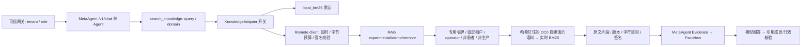

# MetaAgent × RAG Integration Spike — 2026-10-11

基线：MetaAgent `86c5a78`；RAG Portfolio `50abf26`。实际目录为 `D:/Project/rag-portfolio`，任务书中的 Portfolio 不存在。当前 metaknowledgeBase 是第三个独立项目，本次不修改。RAG 原有 `outputs/` 未跟踪文件保留，不读取私有正文、`.local/` 或医学 Gold。

| 现有位置 | 最小改动 | 保留边界及原因 |
|---|---|---|
| MetaAgent agent/tools.py → KnowledgeAdapter | adapter 后端开关、独立 HTTP client | search_knowledge 参数不变；不重写 LangGraph、Dify 或患者工具 |
| KnowledgeAdapter → Repository → FactBuilder | 远程 snippet 保存 Evidence，映射 FactView | Evidence ID 是运行证据 ID；doc_ref 是文档版本/章节 ID |
| agent/runtime.py 最终回答 | 远程模式调用小型引用审计函数 | 核验引用属于当前作用域且 Evidence 未过期；不宣称语义/临床正确率 |
| RAG api/auth.py、config.py、main.py | 专用 demo token 与 experimental route | 原正式鉴权、P1 审核、/v1/retrieve 501 均保留；不伪装 P2-E 发布 |
| evaluation/retrievers.py LocalBM25Retriever | 复用实时 BM25 算法 | 不使用 ArchivedDenseRetriever、历史 Top-5、Gold 或私有索引 |
| 两个 compose.yaml | 独立 compose.integration.yaml | 新项目/端口，无数据库卷；不重建现有部署 |

职责：RAG 负责检索、语料批准与原文定位；服务令牌绑定固定演示 tenant/scope，网关注入身份，模型只提供 query/domain。MetaAgent 保存作用域隔离的 Evidence 和 FactView，形成回答并验证引用。远程失败不回退本地。分数仅排序分数。演示材料为合成研究方案，无患者/真实试验结果，clinical_approval=false；technical_demo 批准不是临床批准。

核验细节：原 search_knowledge 在 `agent/tools.py` 的 TOOL_SPECS 注册，通过 StructuredTool 和 CURRENT_RUN 绑定 RunContext；同一 KnowledgeAdapter 也供 legacy dispatcher 使用。原工具参数为 query/domain，原 TaskResult 包含 status/code/message、Evidence IDs、FactViews、outputs。local_bm25 只读取显式批准且 approved_by 非空的 domain 文档，空命中为 unavailable/no_knowledge_evidence，文件缺失为 knowledge_unavailable；原本地文件不是多租户发布注册表，只有 Evidence 按 scope_hash 隔离。本次不把这类文件声称为生产多租户库。

默认预算：8 次模型调用、16 次后端工具调用、单工具 15 秒、整轮 60 秒；本地 Knowledge 原本不占 ctx.call 的后端次数，本次 remote_rag 显式计数并复用 PriorityLimiter。远程单请求默认 5 秒（最大15），最多6片段、单段1600字符、总片段6000字符、HTTP解码后64KiB；整轮及工具外层时限继续生效。FactView 仍由 FactBuilder 原子字段生成，既有工具消息裁剪、历史预算与 fresh_history 均保留。

RAG 现有 Dense 服务依赖 DashScope/Qdrant/PostgreSQL 和 approved corpus hydrate；现有医学 runner 依赖私有 `.local/` 快照与实验题集。`ArchivedDenseRetriever` 只重放已冻结结果，不能用于本次在线 API。没有发现可直接挂到该演示端点的已批准公开向量 release，正式 release API 尚未实现。因此复用纯 LocalBM25Retriever，服务启动后从经过人工/操作者显式 pin 的自建原文构建内存索引，每个 query 实时计算分数。这是实时 BM25 演示，不是 Dense/RRF/Reranker 在线接入或医学 v3 能力的等价证明。

协议固定为 demo-1，JSON Schema 在 `docs/integration-contract/`。request_id 由受控 HTTP 客户端创建，服务端返回 retrieval_run_id；source_id/chunk_id 是稳定 UUID5，doc_ref 标识文档版本/章节，Evidence ID 是独立运行记录。正文区间为 Unicode `[start,end)`；文本来自 corpus 文档精确切片，page=null。服务返回 HMAC-SHA256 签名（覆盖规范 JSON 全部字段，signature 除外），客户端在 Schema 校验前验证签名，随后验证 pin、请求ID、引用组合、UUID、文本hash和区间长度。签名验证服务来源与传输完整性；不取代审批或语义验证，生产仍需正式身份委托与 TLS。

现有 MetaAgent Compose 没有声明跨项目 RAG 网络；README 描述 Dify 已连接的共享网络，但引擎不可用，无法核实实际网络附件。本次独立 Compose 的语法及 extends 路径已经检查，新建的默认网络供两个演示容器通信，不修改既有网络。

风险：BM25 的弱词匹配不证明答案充分；引用成员与签名也不证明陈述得到语义支持，验收需逐句核查。生产发布、向量索引发布、临床审批与多租户身份委托留待后续。Docker 当前不可用，容器执行需单列。模型配置仅在获用户授权后由程序加载，不输出密钥。
