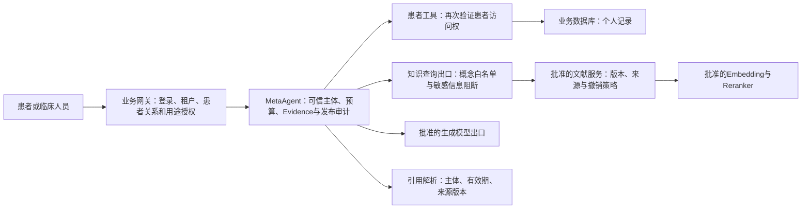

# 真实患者生产接入：设计评估与下一阶段门槛

日期：2026-10-12。依据：本地源码核查、[v2结果](medical-business-v2-results.md)、独立运营人员容器实测。本文是工程设计评估，不授权读取真实患者记录，也不授权向模型供应商发送患者信息。本轮没有接入真实患者。

## 结论

目前具备内部文献检索试用的工程基础，**不满足真实患者生产接入条件**。状态保真与有限过期恢复已实现，但新保留集没有证明完整业务收益，独立语义/临床审阅未完成；旧E09仍出现未查先澄清。C保留为实验候选，v1候选和既有生产服务继续保留。

差距主要在主体授权、患者信息外发控制、生产专用知识策略、业务审阅和运行治理。不能通过删除`production`限制、把角色改成operator或固定发送`X-Patient-Context:false`完成接入。

## 核查到的实际边界

| 位置 | 当前实现 | 对生产设计的影响 |
|---|---|---|
| 运行中的MetaAgent | `meta_agent:docker-cutover-20261008`，生产模式、PostgreSQL；镜像没有当前remote Hybrid路径 | 要发布新的受控镜像并灰度，不能把当前本机源码测试当作现网验证 |
| MetaAgent身份入口 | 原生chat接受经服务Bearer认证的`user/inputs`；Run API从可信接入方头部构造主体 | 服务认证假定上游已验证用户，不能直接接受浏览器自报tenant/role/patient |
| 患者工具后端 | `metaagent-ai-webapi-newdb`的`DifySystemContextValidator`验证服务Token与正整数system user；患者映射接口接受project ID或手机号 | 已有ID映射不等于“这个用户有权查看这个患者”；所读校验路径未体现租户、医患关系与用途授权绑定，必须由可信接入层补足并贯穿后端 |
| 当前Hybrid适配与服务 | production被启动门阻止；仅指定tenant/operator且无患者ID；RAG端固定内部scope | 是隔离验证契约，不能充当临床主体授权契约 |
| 引用审计 | 校验作用域、TTL、正文hash、语料/index双pin与模型可见引用成员；不判断语义支持 | 引用合法不能证明句子正确；生产须另做语义及临床审阅 |
| 发布失效 | 检索服务在返回前复查active与generation；内部入口展示前再检查generation | 原生Agent审计仍主要检查pin，尚无贯穿原生SSE/工具/最终发布的生产撤销租约；需完整实现，不能仅依赖入口ready |
| 持久化与扩容 | PostgreSQL独占实例租约、单worker，Evidence/Run/对话TTL | 可以先单实例受控试点；多副本前需跨进程协调、事件通知与租约恢复 |

核查源码：MetaAgent `api/routes.py`、`api/agent_routes.py`、`orchestration/identity.py`、`domains/remote_hybrid.py`、`domains/knowledge_citations.py`、`infrastructure/container.py`；后端`AI_WebApi.Model/AITools/DifySystemContextValidator.cs`、`AI_WebApi/Security/DifyServiceRequestAuthenticator.cs`、`Controllers/PatientIdentityMappingToolsController.cs`。后端核查HEAD为`57a423be042dd53e838462cdfcfb87b45bb1bdf6`，未修改后端。

## 建议的数据流

个人记录与文献证据分别保存，明确来源类型及使用目的。论文中的测量值不能写入患者事实；当前阶段不将患者病历、自由文本或向量写入公开医学库。知识服务通常只需要规范化医学概念，不需要患者姓名、联系方式、业务ID、完整病历或会话历史。

**两条外发链路都要治理**：生成模型可能接收用户原话、档案和工具记录；Embedding/Reranker可能接收由Agent生成的查询。仅从检索请求移除patient_id不能防止其他患者信息经查询正文外发。当前允许使用配置的授权仅覆盖此前约定的非敏感演示文本，不扩展到真实患者。

## 接入前必须完成的工作

1. **贯穿主体授权。** 网关生成短期、明确audience的签名主体，绑定tenant、actor、role、患者授权范围、用途、会话和过期时间；服务端忽略或拒绝冲突的客户端字段。患者工具在每次访问时校验访问权，撤销授权后会话和缓存也失效。服务Token只证明调用服务身份。保留project/robot ID映射，但手机号只在授权的映射服务中处理，不进入Agent事实或模型输入。
2. **生产专用知识策略。** 单独实现默认拒绝的生产后端和策略ID；知识范围由已批准发布清单与授权用途共同决定。患者上下文标记必须真实传递，不能沿用内部operator假身份。保留签名、双pin、scope、来源类型、请求关联和可见性保护。新增字段要版本化并经端到端契约测试，不能把自由stages当作随意扩权入口。
3. **程序控制模型出口。** 根据用途选择获准模型和数据驻留配置；明确哪些患者字段可进入生成模型，哪些信息一律禁止进入知识查询。无法满足数据最小化的查询应阻断或转向获准的本地处理，不能靠提示词承诺脱敏。供应商处理、保留、删除与组织授权条款需由相应负责人确认；本评估没有作合规批准。
4. **完成陈述支持与临床边界验收。** 先完成297轮待审记录中的重点队列，核查额外陈述、术语、无依据扩展与不当拒答。v2提供1924个待审句段，是初始切分，不代表1924项已验证独立事实。先限制为引用文献解释、展示已记录信息及明确缺失；个体化诊断、用药变化、治疗处方和疗效承诺不在首批范围。临床负责人定义允许任务、禁止任务和需要人工接管的情形。
5. **生产运行治理。** 发布前显式迁移，关闭自动建表；独立服务身份与密钥轮换，TLS和网络访问限制；受控日志不记录完整病历、查询正文或凭据，规定Evidence、Checkpoint、Run、备份的保留与删除。测量失败率、模型调用量、延迟分位数、队列和数据库恢复；本轮六路并发仅验证两路接收/四路拒绝，不能据此承诺吞吐SLO。
6. **发布与撤销一致性。** 固定镜像digest、提示词版本、策略、语料与index；返回和最终发布都检查有效发布代次或短期签名租约。撤销后原文引用、历史记忆和SSE重放不能继续作为当前依据。客户端pin与服务发布协调切换；失败返回明确原因，不隐式切库。先演练数据库备份恢复、断网、服务重启、撤销中途发布和版本回滚。

## 分阶段推进与可判定门槛

| 阶段 | 允许的数据与输出 | 进入下一阶段的证据 |
|---|---|---|
| 现在：运营人员实验候选 | 已批准文献与自建非敏感问题；不含真实患者 | 保留已发现问题；完成独立语义审阅，不能用引用成员检查替代 |
| 下一轮：生产契约的合成患者预发 | 自建身份、病历与训练记录；复用真实接口契约；面向测试人员 | 身份/权限/出口/撤销/持久化/发布保护均通过；业务退化解释清楚并经审批收口 |
| 授权临床人员影子试点 | 另行批准的真实数据；系统结果仅供指定人员审阅，不向患者发布 | 数据处理授权与访问控制审计通过；临床负责人逐项评价，事故/停用流程可执行 |
| 有限患者试点 | 已批准任务、人群和数据范围；可人工接管 | 明确责任人、排除范围、监测阈值、回滚条件和服务目标；独立批准后实施 |

下一轮建议先冻结60个合成接入条件：20个主体/权限/隐私条件，20个患者事实/时效/缺失条件，20个文献/个人事实边界及发布撤销条件。加入同名患者、跨tenant、伪造role、换患者后旧会话、授权撤销、手机号进入查询、缺单位/占位零、过期指标、论文值冒充个人值、服务故障和SSE中途撤销。条件数不替代多轮数，Gold、预期拒绝与外发观测点应在运行前封存。

高风险条件要求零主体越权、零未获准患者信息外发、零无效来源发布、零论文值替代患者实测；出现即停止晋级。正常允许任务也必须完成，不能靠全部拒绝达到保护指标。对语义/临床未审项记NOT_ASSESSED。

在已有登录与患者授权服务可复用、后端和审阅人员可配合的假设下，完成生产契约与合成预发验证可按约2–4周工程工作量规划。这是范围估计，不是上线承诺；真实数据授权、独立临床审阅和真实流量运行证据可能成为更长的关键路径。

**建议下一步先做“主体授权贯穿＋模型出口控制＋合成患者预发”，继续保留现有生产门。** 本轮不做真实患者连接或生产切换。
